<p align="center">
  
</p>

<p align="center">
  <a href="#about">关于我</a> · <a href="#expertise">测试能力</a> · <a href="#domains">业务领域</a> · <a href="#workflow">AI 工作流</a> · <a href="#principles">质量理念</a>
</p>

<p align="center"><strong>从用户的一次点击，到接口的一次响应，再到高并发下的稳定运行。</strong></p>
<p align="center"><sub>QUALITY ENGINEERING / WEB & APP / THINK IN SYSTEMS, TEST THE DETAILS.</sub></p>

<a id="about"></a>

## 👋 Hi, I'm Cindy

我是一名测试工程师，测试范围覆盖 **Web / APP**，关注**性能测试、接口测试、自动化测试和 AI 工作流**。

业务范围包括**活动增长、管理后台、Push 消息触达和做市**。我关心功能是否符合预期，也关心数据是否一致、异常是否可恢复，以及真实用户能否顺利完成整条业务链路。

- **把需求变成可验证的场景**：拆解业务规则、边界条件、状态流转与异常路径。
- **把重复验证交给自动化**：让核心链路回归更高效，让结果有日志、有截图、可追溯。
- **把性能问题放到真实场景里**：关注响应时间、吞吐量、错误率，以及压力下的资源表现。
- **把 AI 融入测试流程**：辅助分析需求、设计用例、整理证据和报告，再由人复核关键结论。

> 日常技能：追着偶现问题找线索，把「我这里没问题」变成可以复现的步骤。

<a id="expertise"></a>

## 🧰 Quality Engineering Toolkit

<p align="center">
  
  
  <br />
  
  
</p>

| 能力方向 | 关注的测试问题 |
| :--- | :--- |
| **⚡ 性能测试** | 负载、压力与稳定性场景；P95 / P99 响应时间、吞吐量、错误率；结合 CPU、内存与日志定位瓶颈。 |
| **🔌 接口测试** | 请求与响应契约、鉴权与权限、参数边界、异常码、幂等、重试，以及跨接口的数据一致性。 |
| **🖥️ Web 测试** | 核心业务流程、浏览器兼容、响应式布局、交互反馈，以及页面、接口和数据之间的一致性。 |
| **📱 APP 测试** | 安装与升级、权限、前后台切换、弱网与断网恢复、设备兼容、消息唤起与落地页。 |
| **⚙️ 自动化测试** | 分层组织 API / UI 用例，覆盖冒烟与核心链路回归；关注定位稳定性、数据隔离、断言质量和失败证据。 |
| **🤖 AI 工作流** | 需求拆解、风险梳理、用例草拟、脚本辅助、日志归纳与报告整理；保留证据，并复核业务判断。 |

<a id="domains"></a>

## 🌐 Business Domains

**理解业务规则，才能发现「功能正常」背后的问题。**

| 业务领域 | 测试视角 |
| :--- | :--- |
| **🎯 活动增长 / Growth** | 活动准入、报名与任务进度、奖励计算与发放、重复领取、时间边界、渠道归因及转化链路。 |
| **🗂️ 管理后台 / Admin** | 角色与数据权限、配置生效、审批流、筛选与分页、导入导出、操作审计，以及前后台数据一致性。 |
| **📨 消息触达 / Push** | 人群圈选、触发条件、定时与时区、去重与频控、发送到点击的状态链路、深链跳转与通知权限。 |
| **📈 做市 / Market Making** | 报价精度与价差、订单状态、挂撤单、部分成交、库存与风险边界、行情延迟、断线重连及异常恢复。 |

<a id="workflow"></a>

## 🤖 AI-Assisted QA Workflow

让 AI 参与重复的信息处理，让测试结论始终有依据。

<p align="center">
  
</p>

1. **需求 → 风险地图**：梳理角色、业务规则、状态变化与依赖，找出需要澄清的边界。
2. **风险 → 测试用例**：辅助生成正向、逆向和异常场景，再校验覆盖范围与预期结果。
3. **用例 → 执行证据**：结合接口与 UI 自动化，收集日志、截图、请求响应和复现步骤。
4. **证据 → 人工复核**：确认缺陷与业务影响，区分产品问题、环境问题和脚本问题。
5. **复核 → 回归沉淀**：整理报告，把高价值场景补充进回归用例，持续改进测试流程。

<details>
<summary><strong>🔎 我希望一份缺陷报告回答什么？</strong></summary>

- **在哪里发生？** 环境、版本、设备、账号角色与前置条件。
- **怎样复现？** 明确的操作步骤和必要的测试数据。
- **哪里不符合预期？** 实际结果、预期结果及对应的业务依据。
- **证据是什么？** 截图、日志、请求响应、时间点或链路标识。
- **影响有多大？** 受影响的用户、业务环节、发生条件与风险。

</details>

<a id="principles"></a>

## ☕ My Quality Mindset

```text
Understand the business.   理解业务，再设计测试。
Question the happy path.   主流程之外，还有边界与异常。
Follow the evidence.      用证据定位，用复现沟通。
Automate with intent.      自动化服务于有效的质量反馈。
Keep humans in the loop.  AI 提升效率，判断仍需复核。
```

<p align="center"><strong>Stay curious. Find the edge cases. Build confidence.</strong></p>
<p align="center"><sub>CINDY / QUALITY IS IN THE DETAILS.</sub></p>
